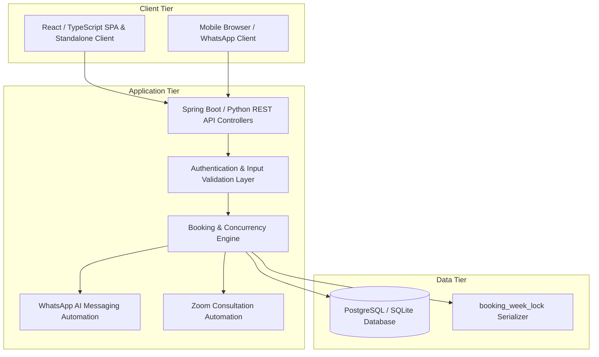
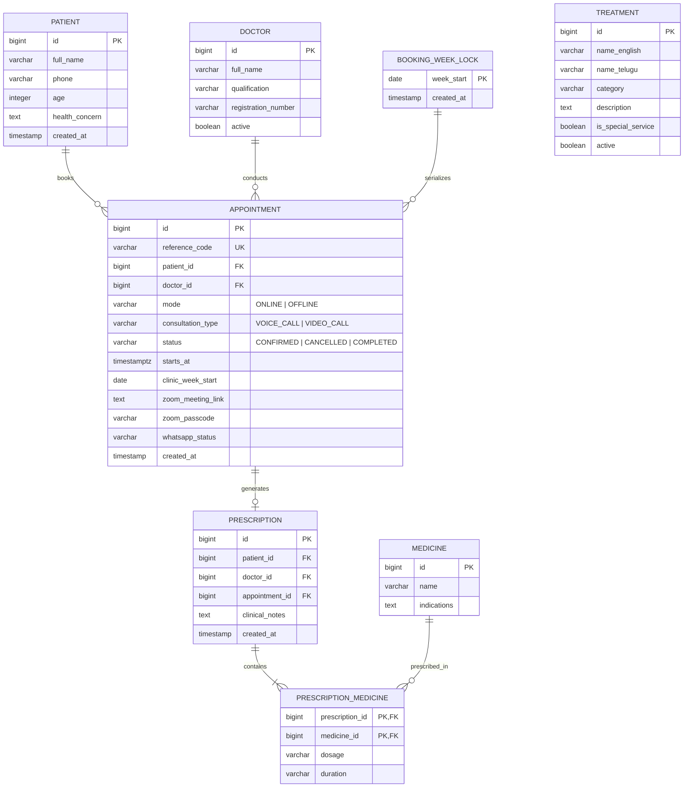

# System Architecture & Database Design — Ayesha Ayurvedic Clinic

## 1. System Overview & Technology Stack
The application is architected as a robust modular monolith adhering to healthcare data integrity and strict scheduling invariants.



### Primary Backend Stack (Production)
* **Language & Runtime:** Java 21 LTS
* **Framework:** Spring Boot 3.x (Spring Web, Spring Data JPA, Spring Security, Bean Validation)
* **Database:** PostgreSQL 16 with Flyway Database Migrations
* **Build System:** Apache Maven
* **Zero-Dependency Development Engine:** Dual Python 3 server (`server.py`) with standard library SQLite support for instant zero-dependency execution and offline testing on Windows environments without requiring Docker or external installations.

---

## 2. Concurrency & Capacity Invariant Enforcement

### 2.1 The Overbooking Problem
In healthcare scheduling, when multiple patients attempt to book the final available consultation slot simultaneously, naive `SELECT count(*) ... THEN INSERT` logic fails under concurrent load, leading to double-booking and capacity overage.

### 2.2 Locking Mechanism
We enforce weekly quota serialization using a dedicated table: `booking_week_lock`.
* When a booking transaction begins, the backend identifies the Monday-based clinic week in `Asia/Kolkata`:
  ```sql
  -- Ensure week row exists
  INSERT INTO booking_week_lock (week_start) VALUES (:mondayDate)
  ON CONFLICT (week_start) DO NOTHING;

  -- Acquire pessimistic write lock
  SELECT week_start FROM booking_week_lock WHERE week_start = :mondayDate FOR UPDATE;
  ```
* Inside the locked transaction:
  1. Count existing confirmed online appointments for the selected date: `COUNT(*) WHERE date(starts_at AT TIME ZONE 'Asia/Kolkata') = :date AND mode = 'ONLINE' AND status = 'CONFIRMED'`. If `>= 3`, abort transaction with `409 Conflict`.
  2. Count existing confirmed online appointments for the entire Monday–Sunday week: `COUNT(*) WHERE clinic_week_start = :mondayDate AND mode = 'ONLINE' AND status = 'CONFIRMED'`. If `>= 6`, abort transaction with `409 Conflict`.
  3. Verify exact slot conflict: `uq_active_exact_slot` unique partial index on `(starts_at, mode) WHERE status = 'CONFIRMED'`.
  4. Create patient and appointment record.
  5. Commit transaction and release row lock.

---

## 3. Relational Database Schema (PostgreSQL)



---

## 4. WhatsApp & Zoom Automation Architecture

### 4.1 Automated Workflow
1. **Appointment Creation Trigger:** The `BookingService` delegates to `WhatsAppAutomationService` and `ZoomAutomationService`.
2. **If Consultation Type == VIDEO_CALL:**
   * Zoom service generates a personalized meeting room with secure passcode and expiration timestamp.
   * Meeting URL and passcode are persisted on the `appointment` record.
   * WhatsApp notification payload includes the meeting URL, start time, and guidelines.
3. **If Consultation Type == VOICE_CALL:**
   * Meeting link is omitted.
   * WhatsApp notification payload confirms that Dr. Ayesha Shaik will call the patient directly on their phone number between 5:00 PM and 8:30 PM IST.
4. **Delivery Channels:**
   * Direct webhook dispatcher for WhatsApp Cloud API (configured with `WHATSAPP_API_TOKEN` & `WHATSAPP_PHONE_ID`).
   * Front-end fallback URL generator creating instant `https://wa.me/918465058469?text=...` deep-links for immediate patient synchronization.

---

## 5. REST API Specifications

| Method | Endpoint | Description | Auth |
| :--- | :--- | :--- | :--- |
| `GET` | `/api/clinic` | Authoritative clinic facts, physician credentials, Sunday timings, Google map link | Public |
| `GET` | `/api/treatments` | Catalog of verified Ayurvedic treatments (Telugu & English) | Public |
| `GET` | `/api/availability` | Availability matrix for next 8 weeks (counts per day and week) | Public |
| `POST` | `/api/appointments` | Book new online appointment with Voice/Video option | Public |
| `GET` | `/api/appointments/lookup`| Query booking status using Reference Code + Phone | Public |
| `POST` | `/api/appointments/cancel`| Cancel booking and release capacity | Public (Phone Verified) |
| `POST` | `/api/admin/login` | Secure administrator authentication for clinic staff | Public |
| `GET` | `/api/admin/appointments` | Overview of appointments, weekly capacity stats | Admin |
| `POST` | `/api/admin/appointments/:id/zoom` | Manually generate or update Zoom link & re-notify | Admin |
| `POST` | `/api/admin/appointments/:id/status`| Update status (Confirmed/Completed/Cancelled) | Admin |
