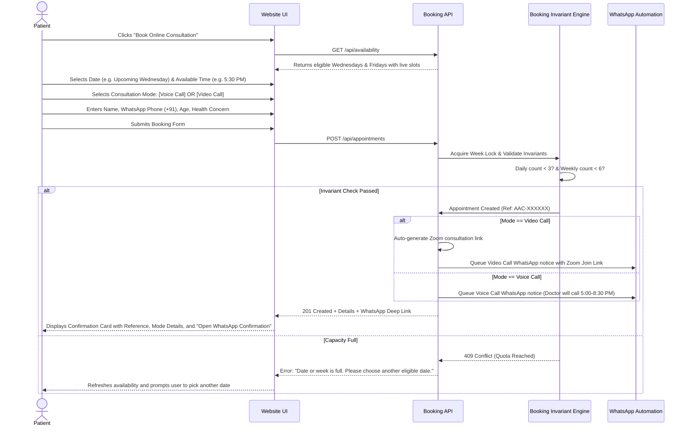

# End-to-End Website & Booking Flows — Ayesha Ayurvedic Clinic

## Flow 1: Public Exploration & Physician Verification
1. **Landing:** Visitor arrives at the homepage.
2. **Physician Verification:** Visitor reads Dr. Shaik Ayesha's credentials (B.A.M.S., Dr. NTR University of Health Sciences, Andhra Board Regn. No. 2545/A/2025). Clicks "View Official Certificate" to inspect the verified Andhra Board of Ayurveda registration document.
3. **Services Exploration:** Visitor browses the bilingual treatment catalog (Panchakarma, Suvarnaprashana, Skin, Hair, PCOD, Joint Care, Acidity, Diabetes, etc.).
4. **Offline Hours Review:** Visitor reads the Sunday in-clinic hours (9 AM–12 PM & 4 PM–8 PM) and views the interactive Google Map pin for Thollabazar, Tiruvuru.

---

## Flow 2: Online Consultation Booking & Mode Selection

---

## Flow 3: Consultation Mode Distinction & Automation Content

### Mode 1: Voice Call (ఫోన్ కాల్ సంప్రదింపు)
* **What happens upon booking:**
  1. Appointment is registered under `consultation_type = 'VOICE_CALL'`.
  2. The on-screen confirmation card states:
     > **Appointment Confirmed!**  
     > Dr. Ayesha Shaik will call your registered phone number (**+91 XXXXXXXXXX**) on **[Date]** between **5:00 PM and 8:30 PM IST**. Please keep your phone reachable.
  3. WhatsApp automation sends this exact confirmation text to the patient's phone and alerts the clinic.

### Mode 2: Video Call (వీడియో కాల్ సంప్రదింపు)
* **What happens upon booking:**
  1. Appointment is registered under `consultation_type = 'VIDEO_CALL'`.
  2. The backend generates a secure Zoom Meeting Room ID, passcode, and join link:
     `https://us05web.zoom.us/j/AAC-[Ref]`
  3. The on-screen confirmation card states:
     > **Appointment Confirmed!**  
     > Dr. Ayesha Shaik will send your secure Zoom video consultation meeting link to your WhatsApp number prior to your scheduled consultation.  
     > *Meeting Room:* Ready · *Passcode:* Protected
  4. WhatsApp automation dispatches the Zoom meeting invitation directly to the patient's WhatsApp.

---

## Flow 4: Sunday Offline Clinic Visit (ఇన్-క్లినిక్ విజిట్)
* **Policy:** Physical walk-in consultation at the clinic.
* **Hours:** Every Sunday (Morning: 9:00 AM – 12:00 PM | Evening: 4:00 PM – 8:00 PM).
* **Location:** 10-188, Tholla Bazar, Near Congress Office / Jaibhavi Centre, Tiruvuru, Krishna District, AP - 521235.
* **Navigation:** Embedded Google Map with direct navigation button launching `https://maps.app.goo.gl/wo1SKmo2VKCcEe8G8?g_st=ac`.
* **Phone Assistance:** One-tap call to `+91 8465058469` or `+91 9848339262` for directions.

---

## Flow 5: Patient Booking Lookup & Cancellation
1. Patient navigates to **"Track Booking"**.
2. Enters **Booking Reference Code** (`AAC-XXXXXX`) and **Phone Number**.
3. System validates ownership:
   * Displays confirmed appointment details, date, time, consultation mode, and Zoom link (if Video Call).
   * Provides a **"Cancel Appointment"** button.
4. Upon cancellation:
   * Status is updated to `CANCELLED`.
   * Capacity is immediately restored for that Wednesday/Friday and that clinic week.
   * Cancellation notification is dispatched to patient and clinic.

---

## Flow 6: Administrator Management Portal
1. Clinic staff logs in at `/admin` using secure credentials.
2. Dashboard shows:
   * **Weekly Capacity Gauge:** Total booked online consultations for the current clinic week (`X / 6`).
   * **Wednesday Gauge:** `X / 3`.
   * **Friday Gauge:** `Y / 3`.
3. Upcoming Appointments Table:
   * Filterable by Date, Week, Status, and Consultation Mode (Voice / Video).
   * Patient Name, WhatsApp Phone, Chief Complaint, Consultation Mode.
   * Actions: One-click "Dial Phone", One-click "Send Zoom Link via WhatsApp", "Mark Completed", "Cancel / Reschedule".
